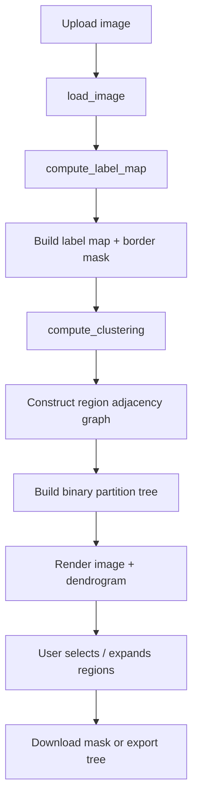
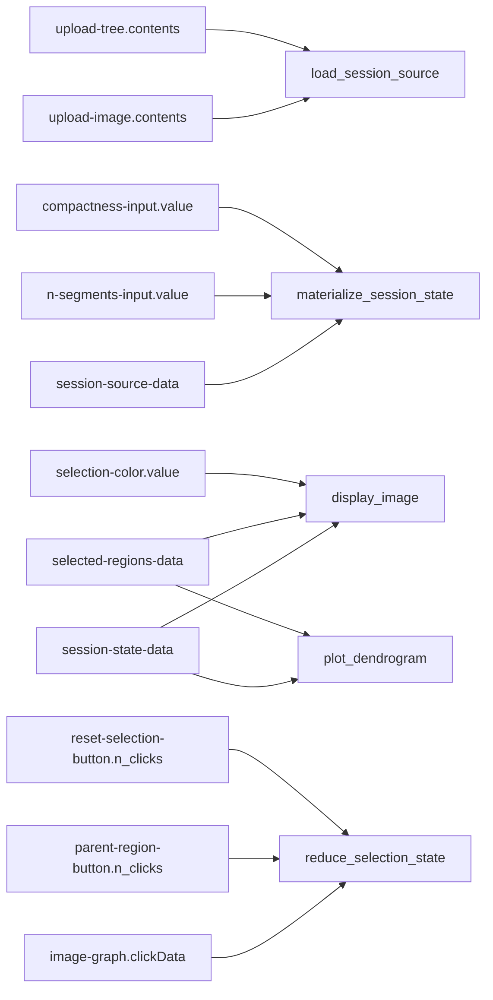

# Developer guide

This document describes how the project is structured, how the core segmentation pipeline works, and how to run the checks needed during development.

## Project layout

```text
.
├── app.py
├── README.md
├── mkdocs.yml
├── doc/
│   ├── index.md
│   ├── user-guide.md
│   ├── architecture.md
│   └── development/
│       └── index.md
├── src/
│   ├── compute/
│   │   ├── __init__.py
│   │   ├── _attribute.py
│   │   ├── _bpt.py
│   │   ├── _clustering.py
│   │   ├── _lca.py
│   │   └── _rag.py
│   └── ui/
│       ├── callbacks/
│       │   └── index/
│       ├── pages/
│       └── __init__.py
├── tests/
├── pyproject.toml
├── Dockerfile
├── flake.nix
└── site/
```

The application entry point is `app.py`. The actual logic is split between:

- `src/ui/`: the Dash UI and callback logic
- `src/compute/`: numerical and structural segmentation utilities

## Environment setup

This project requires Python 3.13 and uses `uv` for package management.

### Local development

```bash
uv sync --group dev
uv run app.py
```

### Documentation build

```bash
uv run --extra doc mkdocs build
```

### Linting and type checking

```bash
uv run ruff check .
uv run ty check .
```

## Runtime architecture

The app is organized as a single-page Dash interface. The user actions are driven by callback functions that store a session state and update the image and dendrogram views.

### Key data structures

The main session state is produced by `materialize_session_state` in `src/ui/callbacks/index/_session_state.py`. It contains:

- `image_data`: the original image payload
- `label_map`: the SLIC label map
- `border`: a border mask used to draw region boundaries
- `hierarchy_parent`: the parent array representing the merge hierarchy
- `hierarchy_altitude`: merge costs used for dendrogram height
- `tree_import_mode`: whether the state came from a previously exported tree
- `initial_selected_regions`: selection restored from an imported tree

## Main processing pipeline



## Core algorithms

### SLIC segmentation
The segmentation starts in `src/ui/callbacks/index/_compute_label_map.py` and uses `skimage.segmentation.slic`.

The generated label map is then processed with a morphological dilation to compute a border mask:

```python
segments = slic(img, n_segments=n_segments, compactness=compactness, start_label=0)
dil = dilation(segments, footprint_rectangle((3, 3)))
borders = segments != dil
```

This makes it easy to overlay region boundaries on top of the image while keeping the segmentation itself visible.

### Region adjacency graph
The region adjacency graph is implemented in `src/compute/_rag.py`. It walks each pixel neighborhood and records the distance between neighboring regions.

The graph is represented as a square adjacency matrix with `-1` values for non-edges. This is used to compute a cost-aware merge structure.

### Binary partition tree
The binary partition tree is built in `src/compute/_bpt.py`. The merge strategy is based on the adjacency matrix and maintains accumulators for region area and mean color values.

The assembly uses a priority queue to repeatedly merge the least-cost neighboring regions and updates the parent array. This yields a hierarchical structure that can be traversed upward and downward.

### Lowest common ancestor queries
The project includes a dedicated LCA utility in `src/compute/_lca.py` to answer ancestry and descendant queries efficiently. This is used when expanding a selected region to its parent cluster in a hierarchical selection.

The `select_parent_cluster` function in `src/ui/callbacks/index/_select_region.py` uses the hierarchy to find the minimal region enclosing the current selection and then move one node upward.

## Dash callback flow

The callback state machine is the heart of the UI logic. The page in `src/ui/pages/_index.py` wires the input controls and stores to the following flow:



The image is redrawn from the current segmentation state, while the dendrogram is recomputed from the hierarchy parent and altitude arrays.

## Testing

The project uses `pytest` for the test suite in `tests/`.

```bash
uv run pytest
```

Dash browser tests are marked separately and can be activated with:

```bash
uv run pytest --run-dash-e2e --headless -m dash_e2e
```

## Contribution guidelines

To maintain a clean working tree:

- keep the UI logic in the Dash callback layer
- keep numerical algorithms in `src/compute/`
- add tests for any change in hierarchy logic or region selection behavior
- prefer small, explicit functions over large monolithic blocks
- keep documentation aligned with behavior when changing the interface

## Next steps

If you want to extend the project, the most natural places to contribute are:

1. better region-selection logic and hierarchy navigation
2. alternative clustering strategies and distance metrics
3. export/import format improvements
4. additional image processing presets
5. more robust integration tests for interactive selection

This project is a good fit for research-driven segmentation experiments because the data flow is deliberately transparent and each stage is exposed as a clear intermediate object.