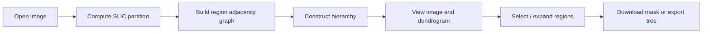

# Hierarchical Segmentation Selector

This project is an interactive segmentation tool for exploring hierarchical image partitions. It is designed primarily for research workflows in which a user wants to select and refine regions from a computable image hierarchy without manually annotating every pixel.

## What the app does

The application loads a source image, computes a superpixel partition with SLIC, and builds a hierarchical merge tree from the region graph. The user can then:

- inspect the full image with selected regions highlighted
- view a dendrogram representing the merge hierarchy
- click a region to select it
- expand the selection to its parent region in the hierarchy
- export the current segmentation state for reuse later

This makes the tool useful for annotation, exploratory image analysis, and rapid prototyping of hierarchical segmentation algorithms.

## Main capabilities

### 1. Image loading
The app accepts standard image files and converts them to a `numpy` array for internal processing.

### 2. Superpixel generation
The image is segmented using `skimage.segmentation.slic`, which creates a compact, regularized over-segmentation with configurable parameters:

- `n_segments`: target number of superpixels
- `compactness`: balance between spatial proximity and color similarity

### 3. Hierarchical clustering
Once the superpixels are computed, the code builds a region adjacency graph and a binary partition tree. Each merge event is assigned an altitude: a scalar distance that describes how expensive the merge was.

### 4. Interactive selection
The user can click a region in the image to select it. The selected region is highlighted and the corresponding leaves in the dendrogram are emphasized. The selection can be toggled or expanded upward through the parent cluster operation.

### 5. Persistence
The current hierarchical tree can be exported to a compressed JSON payload, which is useful when a user needs to resume or share a segmentation session without recomputing the image graph.

## Quick start

```bash
uv run app.py
```

Then:

1. click Open Image
2. adjust the segmentation settings
3. inspect the dendrogram
4. select a region on the image
5. use Parent region to move up the hierarchy
6. export the mask or tree when ready

## Typical workflow



## Where to look next

- [User guide](user-guide.md) for the complete interaction workflow
- [Architecture guide](architecture.md) for the data model and algorithm pipeline
- [Developer guide](development/index.md) for setup, testing, and implementation details

## Project status

This project is a working research prototype and is structured for fast iteration on segmentation workflows. The core functionality is implemented in the `src/` package and the app entry point is `app.py`.